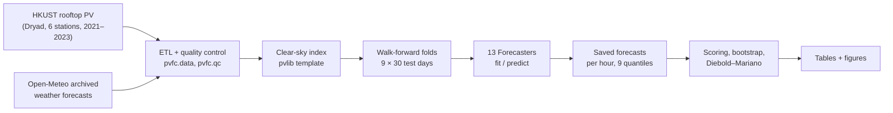

# Can time-series foundation models forecast rooftop solar power a day ahead?

[](environment-lock-pv-definitive-2026-10-14.yml)
[](https://pytorch.org)
[](tests/)
[](https://github.com/astral-sh/ruff)
[](LICENSE)

A benchmark of **13 forecasting models** for **day-ahead hourly PV power** at six rooftop solar
stations in Hong Kong. It compares **zero-shot and fine-tuned time-series foundation models**
(Chronos-2, TimesFM-3, TiRex-2) with **purpose-trained models** (SARIMA, LightGBM, LSTM) and the
standard reference forecasts of the solar field. All 156 runs (13 models × 2 weather settings × 6
stations) ran on a **16 GB MacBook Air** in 20 hours.

This is the code of my Bachelor's thesis, BSc in Artificial Intelligence (Università degli Studi di
Milano, Milano-Bicocca and Pavia), December 2026.


## Key results

| | |
|---|---|
| **Weather forecasts carry the skill** | With weather forecasts as inputs, the four best models cut daytime RMSE by 26–31% relative to CLIPER, the standard climatology-persistence reference. Without them, no model is shown to beat CLIPER. |
| **Zero-shot foundation models are competitive, not better** | TimesFM-3 ranks first, with 31% lower RMSE than CLIPER and no training on the site. But no foundation model is shown to beat LightGBM (28%), the strongest trained model. |
| **Fine-tuning closes the gap for a small model** | Fine-tuning lifts Chronos-2-small from 12% to 26%, statistically level with LightGBM, at about the cost of training LightGBM. |
| **Calibrated uncertainty** | With weather forecasts, the fine-tuned model's forecast intervals are the closest to calibrated. LightGBM's and SARIMA's are too narrow; the zero-shot Chronos-2 and TimesFM-3 intervals are too wide. |
| **It runs on a laptop** | Every model fits in 16 GB of memory and forecasts a month at one station in at most about four minutes, training included. |

"Shown to beat" means significant at 5% in a Diebold–Mariano test on daily losses with Holm
correction. Each interval is a 95% block-bootstrap interval over the test days.

## What this project involves

- **Data engineering on real, messy sensor data.** An ETL for the HKUST rooftop PV dataset reads
  15-minute and hourly inverter records and finds each station's nameplate capacity in its
  building-metadata graph. Quality control removes meter errors and impossible night readings and
  detects outages (`pvfc.data`, `pvfc.qc`).
- **A physics-informed target.** The models forecast the *clear-sky index*: power divided by an
  empirical clear-sky power template built with `pvlib` from the solar geometry and fit on the
  first training year only, so no test data leaks into it (`pvfc.clearsky`, `pvfc.normalize`).
- **A strict day-ahead protocol.** Forecasts are issued at local midnight for the next 24 hours,
  with expanding-window walk-forward validation over nine 30-day test windows (July 2022 to November
  2023). Every model gets the same folds, inputs and scoring, enforced by one shared interface.
- **13 models behind one interface.** Five references (persistence, seasonal naive, smart
  persistence, climatology, CLIPER). Three trained models (SARIMA, LightGBM, LSTM). Four zero-shot
  foundation models from 28M to 331M parameters, and one fine-tuned. The foundation models read
  the weather forecasts as known-future covariates.
- **Careful evaluation.** Point and probabilistic scores: RMSE skill, quantile score, interval
  coverage and reliability. 95% moving-block bootstrap intervals and Diebold–Mariano tests with
  Holm correction for the comparisons.
- **Reproducibility.**
  - A conda lock file pins every package.
  - Each Hugging Face checkpoint is pinned to a commit.
  - Every result row is keyed by a hash of its configuration and records its environment.
  - The run's configuration, analysis scripts and environment lock were SHA-256-hashed before the
    batch started.
  - 201 tests cover the data pipeline, the day-ahead protocol (local-day folds, no target in the
    future frame, a training-only template), every model wrapper, the scoring and the report.

## Results

Daytime hours, mean over the six stations, with weather forecasts as inputs. Skill is
1 − RMSE / RMSE of CLIPER: 0.30 means 30% lower RMSE than CLIPER.

| Model | Kind | Skill (95% interval) | Skill, no weather | Time per 30-day window |
|---|---|---:|---:|---:|
| TimesFM-3 | foundation, zero-shot | **0.314** [0.259, 0.363] | 0.022 | 130 s |
| LightGBM | trained | 0.280 [0.231, 0.326] | 0.008 | 167 s |
| Chronos-2 base | foundation, zero-shot | 0.269 [0.224, 0.312] | 0.003 | 45 s |
| Chronos-2 small, fine-tuned | foundation, fine-tuned | 0.257 [0.196, 0.314] | 0.006 | 154 s |
| LSTM | trained | 0.211 [0.152, 0.267] | −0.094 | 141 s |
| SARIMA | trained | 0.200 [0.160, 0.235] | 0.005 | 103 s |
| TiRex-2 | foundation, zero-shot | 0.186 [0.122, 0.243] | 0.005 | 13 s |
| Chronos-2 small | foundation, zero-shot | 0.118 [0.073, 0.164] | −0.004 | 2 s |
| CLIPER | reference | 0 | 0 | < 1 s |
| Smart persistence | reference | — | −0.131 | < 1 s |

The time is the median, over stations and windows, of fitting the model and issuing the
window's 30 daily forecasts on the M4 MacBook Air. The full tables are in
[`thesis/tables/`](thesis/tables/): [skill](thesis/tables/master_skill.md),
[probabilistic scores](thesis/tables/probabilistic.md), [compute](thesis/tables/compute.md),
[significance tests](thesis/tables/significance.md).


## How it works



Every model implements the same two-method contract (`src/pvfc/models/base.py`). The runner
loops over models, folds and stations, and hands each model only what is known at the issue
time:

```python
class Forecaster(ABC):
    def fit(self, train: pd.DataFrame) -> "Forecaster": ...
    def predict(self, history: pd.DataFrame, future: pd.DataFrame) -> pd.DataFrame:
        """One forecast (y_hat, optionally q0.1..q0.9) per future timestamp.
        `future` carries only information available at issue time."""
```

| Module | Role |
|---|---|
| `src/pvfc/data.py`, `qc.py`, `weather.py` | ETL, quality control, Open-Meteo weather archive |
| `src/pvfc/clearsky.py`, `normalize.py` | clear-sky power template, clear-sky index, gap filling |
| `src/pvfc/splits.py`, `runner.py` | walk-forward folds on local days; the model × fold × station loop |
| `src/pvfc/models/` | references, darts adapters (SARIMA, LightGBM, LSTM, Chronos-2), TimesFM-3 and TiRex-2 wrappers |
| `src/pvfc/evaluation.py` | point and probabilistic metrics, reliability |
| `experiments/` | the batch runner, data and run checks, rescoring, the report |
| `configs/experiment.yaml` | every setting of the run: stations, folds, the 13 models |

## Quickstart

No download needed: the harness runs end to end on a synthetic station.

```bash
mamba env create -f environment.yml -n pv && conda activate pv
python -m pip install -e ".[forecast,covariates,dev]"
make test     # 201 tests in about a minute; the 11 that need the dataset skip without it
python experiments/run.py --config configs/experiment.yaml --synthetic \
    --results /tmp/smoke.parquet --no-predictions
```

## Reproducing the full run

The exact environment is
[`environment-lock-pv-definitive-2026-10-14.yml`](environment-lock-pv-definitive-2026-10-14.yml)
(macOS on Apple silicon; the neural models run on the GPU through MPS).

```bash
# 1. Download Dataset.zip by hand into data/raw/ (the Dryad page blocks scripts):
#    https://datadryad.org/dataset/doi:10.5061/dryad.m37pvmd99
# 2. Data, weather and checkpoints (needs the network)
make data          # extract and inspect the dataset
make nwp-cache     # Open-Meteo weather archive for 2021-2023
make checkpoints   # the four foundation-model checkpoints, at their pinned commits
# 3. The 156 runs, offline and resumable (about 20 h on an M4 MacBook Air)
HF_HUB_OFFLINE=1 make panel
# 4. Scores, tables and figures
make report        # -> thesis/tables/ and thesis/figures/
```

`python experiments/check_runs.py --predictions-dir results/predictions --logs-dir results/logs --expect-files 156`
checks every saved forecast and log after the batch.

## Limitations

- **The weather inputs are better than a real day-ahead forecast.** The Open-Meteo archive
  stitches together the first hours of successive weather-model runs. Most scored hours come from
  runs that start after the midnight issue time. The results with weather are therefore an upper
  bound on what the models would achieve in operation.
- **One site.** The six stations share one campus and one subtropical climate, and their errors are
  strongly correlated.
- **Pretraining overlap.** TimesFM-3 and TiRex-2 were released after the dataset was published, so
  it may be in their pretraining data. Without weather forecasts they cannot be told apart from CLIPER
  or the trained models, so there is no sign that they recall the test days.
- **Development runs.** Some protocol choices were made after earlier runs on the same test
  windows. The thesis lists them.

## Data and model licences

- **Code:** MIT ([LICENSE](LICENSE)).
- **Data:** HKUST rooftop PV dataset, Lin et al., *Scientific Data* 12:63 (2025),
  [doi:10.5061/dryad.m37pvmd99](https://doi.org/10.5061/dryad.m37pvmd99), CC0. Weather:
  [Open-Meteo](https://open-meteo.com) Historical Forecast API.
- **Checkpoints** are downloaded at run time, not redistributed:
  - Chronos-2 (`amazon/chronos-2`, `autogluon/chronos-2-small`): Apache-2.0.
  - TiRex-2 (`NX-AI/TiRex-2`): Apache-2.0.
  - TimesFM-3 (`google/timesfm-3.0-pytorch`): TimesFM non-commercial licence v1.0, research use
    only. It must be accepted with `accept_license: true` in the configuration.

## About

Lorenzo Spolti, BSc in Artificial Intelligence (Università degli Studi di Milano, Milano-Bicocca
and Pavia). Thesis supervised by Prof. Claudio Cusano, December 2026.
