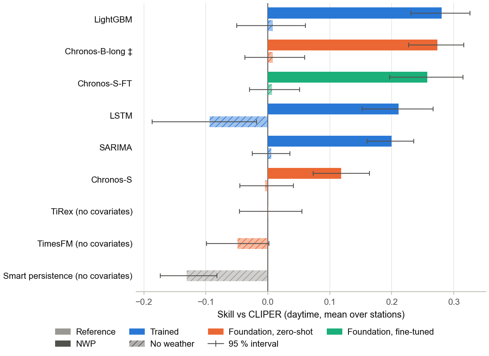
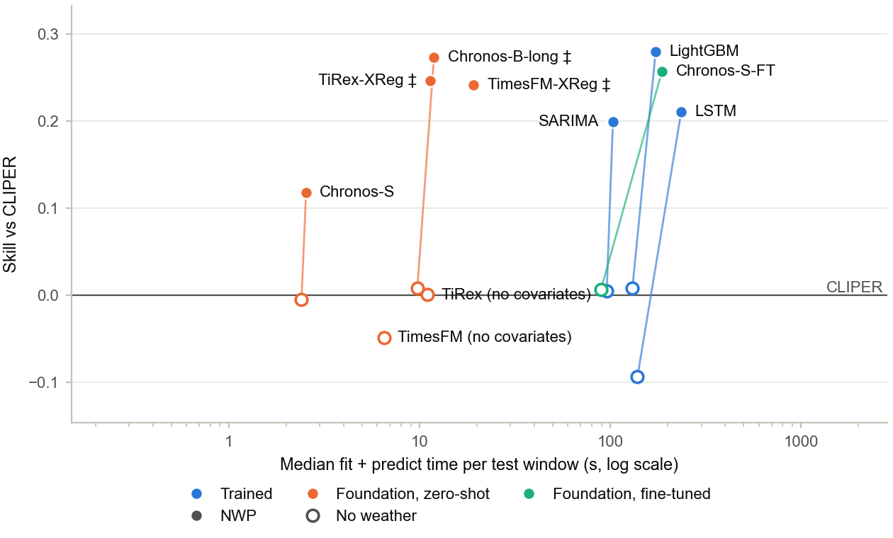

<!--
WORKING SKELETON. Each section opens with an italic *scope note* telling you what
goes there; replace the notes with prose. Numbers, tables and figures come from
`thesis/tables/` and `thesis/figures/` (regenerate with `make report`). Convert to
PDF/LaTeX with e.g. `pandoc manuscript.md --citeproc -o thesis.pdf`, or paste into
the Milano-Bicocca template.
-->

## Abstract

*Scope note: 150–250 words. State the question, the dataset (HKUST rooftop PV,
2021–2023), the harness (one shared clear-sky-index pipeline), the model families
compared, the headline finding (do foundation models — zero-shot and fine-tuned —
match/beat purpose-trained models on day-ahead hourly PV power on an M4/16 GB), and
the compute cost. End with one sentence of significance.*

This thesis asks whether time-series **foundation models** (Chronos-2, TimesFM-2.5,
TiRex, Moirai-2, and the tiny TTM/TinyTimeMixer) — used **zero-shot** and
**fine-tuned** — can match or beat purpose-trained classical, machine-learning,
and deep models (smart persistence, SARIMA, LightGBM, LSTM) for **day-ahead hourly
photovoltaic (PV) power** forecasting on **consumer hardware**, and at what compute
cost. The roster mixes heavy transformer-class models (Chronos-2, TimesFM-2.5,
Moirai-2) with the much smaller TTM (≈1–5 M parameters), specifically so the
consumer-hardware question can be answered for both scales. […]

## 1. Introduction

*Scope note: motivate PV forecasting (grid integration, day-ahead markets); the rise
of pre-trained time-series foundation models; the open question of whether they pay
off against well-tuned baselines on a single, realistic site at low cost. State the
contribution: a single open benchmark harness that scores every model under
identical splits/masking/metrics, on a real multi-year campus dataset, on a laptop.*

Contributions:

1. A reproducible, config-hashed benchmark harness in which every model is a
   `Forecaster` scored by one shared `Runner` over identical causal folds, masking,
   and metrics.
2. A like-for-like comparison of baselines, classical/ML/deep models, and foundation
   models (zero-shot and fine-tuned) for day-ahead hourly PV power.
3. A compute-cost accounting (wall-clock and memory) framing accuracy *per unit of
   compute* on an Apple M4 (16 GB).

## 2. Background and Related Work

*Scope note: (a) solar forecasting verification canon — clear-sky index, skill over a
reference, probabilistic scoring [yang2020verification; yang2019ropes;
lauret2017probabilistic]; (b) purpose-trained models — SARIMA, gradient boosting
[ke2017lightgbm], LSTM [hochreiter1997lstm]; (c) time-series foundation models
[ansari2024chronos; ansari2025chronos2; das2024timesfm; woo2024moirai;
ekambaram2024ttm] and the zero-shot/fine-tuning paradigm.*

## 3. Data

*Scope note: describe the HKUST rooftop PV dataset [hkust_pv_dataset]: ~60 site-level
stations, 2021–2023, 5-min PV power + campus-tower meteorology; the Brick `.ttl`
metadata (per-station nameplate capacity, used to normalize metrics). Describe ETL:
5-min power → hourly mean kW, weather aligned to the same hourly UTC grid, gaps
handled, tz-aware. Two weather regimes: **oracle** (measured, perfect-foresight upper
bound) and **nwp** (Open-Meteo archived forecast [openmeteo]) — and the honesty
caveat that the archived-forecast feed is a best-available near-analysis, not a frozen
24-h-lead forecast.*

Site selection: *state which stations were used and why (capacity range; with/without
panel-level optimizer split). See `PLAN_OF_ACTION.md` §5.*

## 4. Method

### 4.1 Forecasting task

*Day-ahead: at issue time (00:00) forecast the next 24 hourly PV power values.*

### 4.2 Clear-sky-index target

Models predict the **clear-sky index** `k = power / p_clear` rather than raw power,
where `p_clear` is an empirical clear-sky-power template built from a pvlib
[holmgren2018pvlib] clear-sky GHI envelope; power is reconstructed as
`P̂ = k̂ · p_clear` (night zeros imposed automatically). This removes the diurnal
cycle so models learn weather-driven variability.

### 4.3 Covariates

Future covariates known at issue time: the deterministic `p_clear` template, cyclical
calendar encodings, and the chosen weather feed (oracle or nwp). Leakage-free by
construction.

### 4.4 Evaluation protocol

Expanding-window, blocked walk-forward cross-validation on whole-day blocks with an
embargo ≥ horizon (no shuffling). Metrics on the daytime mask (and all-hours as a
robustness check): RMSE, MAE, MBE, R², capacity-normalized nRMSE/nMAE; **skill score**
over **smart persistence**; probabilistic pinball loss, CRPS, PICP-80 and reliability.
The same `Splitter` and `Evaluator` are shared by every model.

### 4.5 Models

| Family | Models |
|---|---|
| Baselines | persistence, **smart persistence** (reference), seasonal-naive |
| Classical | SARIMA (AutoARIMA) |
| ML | LightGBM (quantile) |
| Deep | LSTM |
| Foundation (zero-shot) | Chronos-2, TimesFM-2.5, TiRex, **Moirai-2**, **TTM (TinyTimeMixer)** |
| Foundation (fine-tuned) | Chronos-2, TimesFM-2.5, TiRex, **Moirai-2**, **TTM** *(as compute allows)* |

*Scope note: state context lengths, fine-tuning epochs/frozen-layer policy, and the
darts version used. Chronos-2, TimesFM-2.5, and TiRex are darts-native (>=0.43/0.44).
Moirai-2 and TTM are wired through a separate external-foundation wrapper
(`src/pvfc/models/external_foundation.py`) that lazy-imports their optional libraries
(`uni2ts` for Moirai-2; `granite-tsfm` for IBM's TinyTimeMixer). Both follow the same
arch/label split as the darts foundation roster: zero-shot and fine-tuned variants
score as separate rows. **TTM in particular fits the consumer-hardware story directly:
at ≈1–5 M parameters it is two orders of magnitude smaller than the transformer-class
foundation models and runs comfortably on CPU/MPS on an M4 with 16 GB unified memory,
so it tests whether a tiny pre-trained model can match the heavier transformers on
day-ahead PV without a GPU.** Moirai-2 ("R" variants) rounds out the comparison by
adding a recent any-variate masked-encoder family beside the autoregressive
transformer foundation models. Both are off by default in `configs/experiment.yaml`
and opt-in via `pip install 'uni2ts>=1.2'` / `pip install 'granite-tsfm[notebooks]>=0.2.16'`.*

### 4.6 Reproducibility

Every run is keyed by a SHA1 hash of its fully-resolved config; the environment
fingerprint (library versions, platform) is stored per result row. Harness built on
darts [herzen2022darts].

## 5. Experiments and Results

*Scope note: lead with the master table (`thesis/tables/master_results.md`). Then the
figures: skill-by-model, nRMSE-by-model, calibration (PICP-80 vs 0.8), and the
headline **skill-vs-compute** scatter (`thesis/figures/`). Report oracle vs nwp.*

*Insert `thesis/tables/master_results.md` here (or include it).*

## 6. Discussion

*Scope note: do foundation models earn their compute? Where does zero-shot suffice vs
where fine-tuning helps? oracle→nwp degradation (the cost of real forecast weather).
Calibration quality. Threats to validity: single site/campus, archived-forecast
caveat, capacity proxy where metadata is missing, MPS/CPU non-determinism for the LSTM.*

## 7. Conclusion

*Scope note: one paragraph answering the thesis question, plus future work (more sites,
true day-ahead NWP post-2024, Moirai/TTM via their native libraries, probabilistic LSTM).*

## Appendix A — Reproducibility checklist

*Environment (`environment.yml` + `pyproject.toml` extras), `make` targets
(`env`/`install`/`check`/`test`/`data`/`reproduce`/`report`), config hashes of the
runs behind each table, and the hardware (Apple M4, 16 GB).*

## References

*Generated from `references.bib`.*
